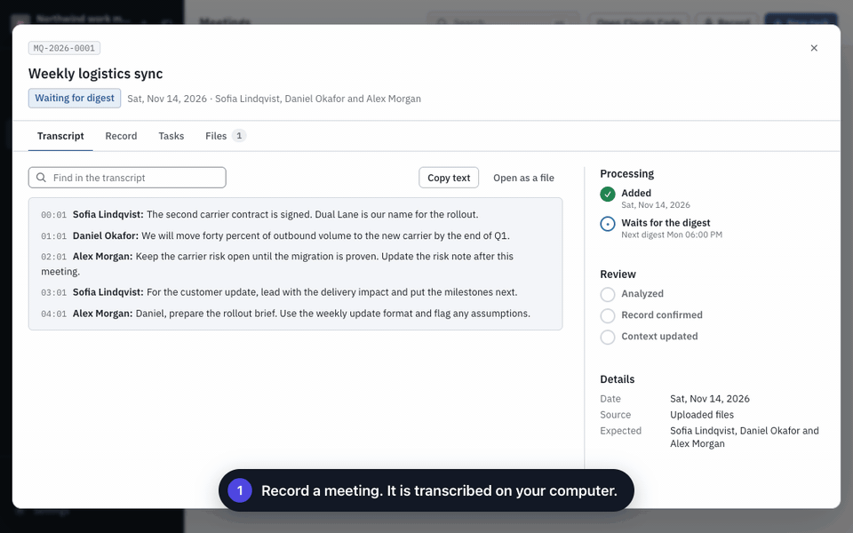
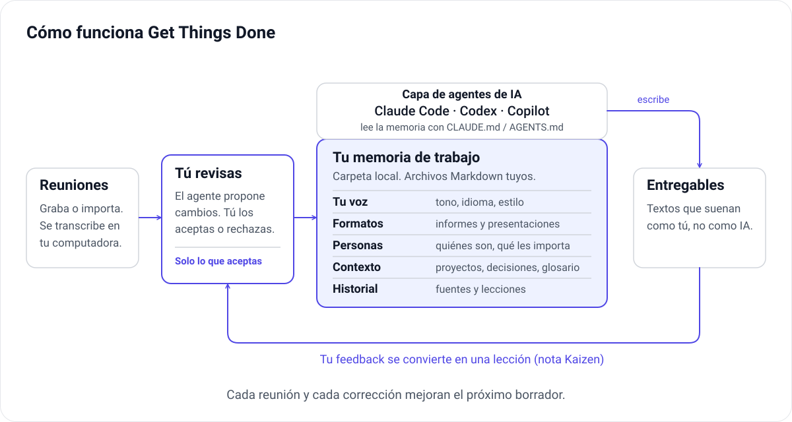

[English](README.md) · [日本語](README.ja.md) · [Português (Brasil)](README.pt-BR.md) · [Español](README.es.md)

<div align="center">

# Get Things Done

**Una memoria para la IA que crece con tu trabajo.**

Registra reuniones, revisa qué cambió y dale a tu IA el contexto necesario para entregar resultados.



<sub>Pantallas reales del panel con datos ficticios de demostración. Las leyendas se agregaron para esta animación.</sub>

</div>

Get Things Done es una **memoria de trabajo** de código abierto y local para **Claude Code, Codex y GitHub Copilot**. Guarda en archivos Markdown simples tu forma de escribir, los formatos que entregas, las personas con las que trabajas y lo que se decidió en tus proyectos. Tu agente de IA lee esos archivos antes de escribir cualquier cosa.

**La memoria se retroalimenta.** Cada reunión que grabas aporta lo que cambió. Cada corrección que haces a un borrador se convierte en una lección. Tú apruebas cada cambio, así que la memoria mejora sin desordenarse, y el siguiente borrador necesita menos explicación y menos ajustes.

## Cómo funciona, en resumen



1. **Las reuniones traen conocimiento nuevo.** Graba o importa una reunión. Se transcribe en tu computadora.
2. **Tú decides qué aprende la memoria.** Un agente compara la reunión con lo que el espacio de trabajo ya sabe y propone pocos cambios: una decisión nueva, un plazo que se movió, un término nuevo para el glosario, lo que espera un colega. Nada entra sin tu aprobación.
3. **La memoria es el cerebro sobre el que funciona tu agente.** Tu voz y preferencias, plantillas de salida, personas, notas de contexto y tareas anteriores están en una sola carpeta. Claude Code, Codex o Copilot las lee con su propio archivo de instrucciones (`CLAUDE.md`, `AGENTS.md` o `.github/copilot-instructions.md`).
4. **Los borradores suenan como tú, no como una IA.** El agente escribe con tu tono y tus formatos, pensando en lo que le importa a cada lector. Tú revisas el resultado y decides cuándo está listo.
5. **Las correcciones cierran el ciclo.** Cuando devuelves un borrador, el agente anota por qué falló la primera versión (una nota Kaizen). Esa nota se convierte en una propuesta de ajuste a las instrucciones o a la memoria, que revisas como cualquier otro cambio.

## Primeros pasos

### Aplicación de escritorio

[Descarga para macOS o Windows](https://github.com/geovanneb/get-things-done/releases/latest). Elige el instalador de tu plataforma y consulta las notas de la versión. Las versiones para macOS están firmadas y notarizadas; la de Windows todavía es una vista previa sin firma.

### CLI y navegador

Requiere **Node.js 20.19 o posterior**; recomendamos 22 o 24.

```bash
npm install -g @bertonha/getthingsdone
mkdir work-memory && cd work-memory
gtd init
gtd start
```

Elige tu herramienta de IA durante la configuración. El panel local se abre en el navegador.

## Prueba el ciclo

1. Agrega a una persona con la que trabajas y escribe unas líneas sobre tu proyecto.
2. Graba una reunión o importa grabaciones y transcripciones. Informa a los participantes y obtén su consentimiento antes de grabar.
3. Antes de transcribir audio, descarga un modelo en **Configuración → Transcripción**.
4. Revisa y aprueba los cambios que propone la IA. Crea una tarea que use ese contexto.
5. Si el borrador no queda bien, usa **Solicitar cambios**. La lección vuelve a la memoria después de tu revisión.

El espacio de trabajo y la transcripción sin conexión no requieren una cuenta de Get Things Done. El análisis y la ejecución de tareas usan la herramienta de IA que elijas, que puede requerir su propia cuenta o suscripción. Tú apruebas los cambios y revisas las entregas.

## Idioma

El panel está en inglés, japonés, portugués de Brasil y español latinoamericano. Sigue el idioma del sistema o del navegador, y puedes cambiarlo en **Configuración → Apariencia → Idioma**. Los menús nativos de la aplicación de escritorio, la CLI y algunos errores del servidor siguen en inglés.

El idioma de la interfaz es independiente del idioma hablado en las grabaciones y del idioma en que la IA escribe los entregables, que defines en tu perfil.

## Documentación y participación

- [Presentación completa (inglés)](README.md)
- [Guía del usuario (inglés)](docs/user-guide.md)
- [Historial de cambios](CHANGELOG.md) y [cómo contribuir](CONTRIBUTING.md)
- [Errores y sugerencias](https://github.com/geovanneb/get-things-done/issues) e [informes de seguridad](SECURITY.md)

Las mejoras a las traducciones son bienvenidas. Usa datos ficticios en los issues y las capturas de pantalla, nunca información real del trabajo.

[Licencia MIT](LICENSE). Esta página resume el README en inglés; consulta la versión completa para ver los detalles.

<!-- English source: README.md as revised for 0.13.1 (memory loop and diagram); concise introduction, not a full translation. -->
