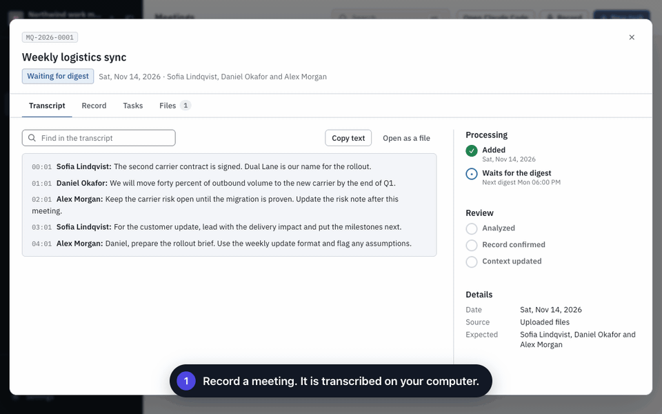
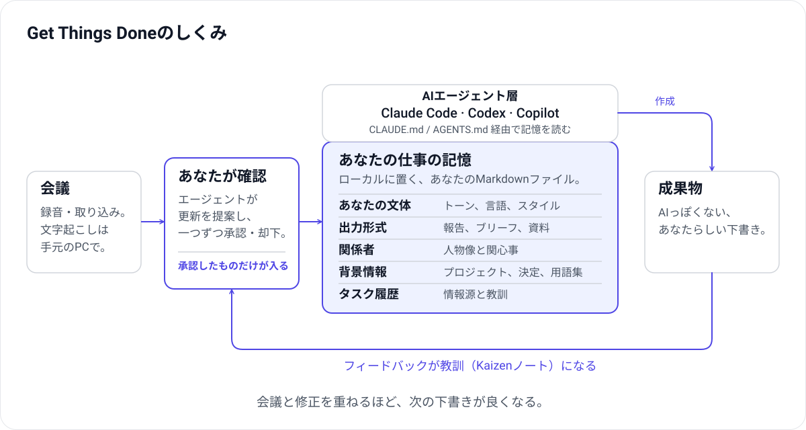

[English](README.md) · [日本語](README.ja.md) · [Português (Brasil)](README.pt-BR.md) · [Español](README.es.md)

<div align="center">

# Get Things Done

**仕事とともに育つ、AIのための記憶。**

会議を記録し、変更を確認し、AIが仕事を進めるための背景情報を整えます。



<sub>実際のダッシュボード画面と架空のデモデータです。ステップの説明文はこのアニメーション用に追加したものです。</sub>

</div>

Get Things Doneは、**Claude Code、Codex、GitHub Copilot**向けの、オープンソースでローカルファーストな**仕事の記憶**です。あなたの書き方、よく作る成果物の形式、一緒に働く人、プロジェクトで決まったことを、シンプルなMarkdownファイルに保存します。AIエージェントは、何かを書く前にこれらのファイルを読みます。

**記憶は自ら育ちます。** 会議を録音するたびに、変わったことが記憶に加わります。下書きを直すたびに、その修正が教訓になります。すべての変更はあなたが承認するので、記憶は散らからずに良くなり、次の下書きでは説明も手直しも少なくて済みます。

## しくみをひと目で



1. **会議が新しい知識を運びます。** 会議を録音または取り込みます。文字起こしは手元のPCで行います。
2. **記憶が何を学ぶかは、あなたが決めます。** エージェントが会議の内容とワークスペースの既存の情報を比べ、新しい決定、変わった期限、用語集に加える言葉、同僚の期待など、少数の変更を提案します。承認するまで何も反映されません。
3. **記憶は、エージェントが動くための頭脳です。** あなたの文体や好み、出力テンプレート、関係者、背景情報、過去のタスクは、ひとつのフォルダーにあります。Claude Code、Codex、Copilotは、それぞれの指示ファイル（`CLAUDE.md`、`AGENTS.md`、`.github/copilot-instructions.md`）を通じてそれを読みます。
4. **AIっぽくない、あなたらしい下書きになります。** エージェントは、あなたのトーンと形式で、読み手ごとの関心に合わせて書きます。完成かどうかは、あなたが確認して決めます。
5. **修正が循環を完成させます。** 下書きを差し戻すと、エージェントは最初の版がずれた理由をKaizenノートに記録します。それが指示や記憶への修正提案になり、ほかの変更と同じようにあなたが確認します。

## はじめる

### デスクトップアプリ

[macOS・Windows版をダウンロード](https://github.com/geovanneb/get-things-done/releases/latest)。お使いのOSに合うインストーラーを選び、リリースノートをご確認ください。macOS版は署名・公証済みです。Windows版は署名なしのプレビュー版です。

### CLIとブラウザー

Node.js **20.19以降**が必要です（22または24を推奨）。

```bash
npm install -g @bertonha/getthingsdone
mkdir work-memory && cd work-memory
gtd init
gtd start
```

初期設定でAIツールを選ぶと、ブラウザーにローカルのダッシュボードが開きます。

## 循環を試す

1. 一緒に働く人を一人登録し、プロジェクトについて数行書きます。
2. 会議を録音するか、録音・文字起こしを取り込みます。録音前に参加者へ説明し、同意を得てください。
3. 音声を文字起こしする前に、**設定 → 文字起こし**で音声モデルをダウンロードします。
4. AIが提案した変更を確認・承認し、その背景情報を使うタスクを作成します。
5. 下書きが期待と違うときは**変更を依頼**を使います。その教訓は、あなたの確認を経て記憶に戻ります。

ワークスペースとオフライン文字起こしにGet Things Doneのアカウントは不要です。AIによる分析やタスク実行には、ご自身のAIツールを使います。そのツールのアカウントや契約が必要な場合があります。変更の承認と成果物の確認はユーザーが行います。

## 表示言語

ダッシュボードは英語・日本語・ポルトガル語（ブラジル）・スペイン語に対応しています。OSまたはブラウザーの言語に従い、**設定 → 外観 → 言語**で変更できます。デスクトップアプリのネイティブメニュー、CLI、一部のサーバーエラーはまだ英語です。

表示言語は、録音の言語や、AIが成果物を書く言語（プロフィールで設定）とは別の設定です。

## ドキュメントと参加

- [詳しい紹介（英語）](README.md)
- [ユーザーガイド（英語）](docs/user-guide.md)
- [変更履歴](CHANGELOG.md)・[貢献方法](CONTRIBUTING.md)
- [不具合報告・機能提案](https://github.com/geovanneb/get-things-done/issues)・[セキュリティの報告](SECURITY.md)

翻訳の改善も歓迎します。Issueやスクリーンショットには、実際の業務情報ではなく架空のデータを使用してください。

[MITライセンス](LICENSE)。このページは英語版READMEの要約です。詳しい仕様は英語版をご参照ください。

<!-- English source: README.md as revised for 0.13.1 (memory loop and diagram); concise introduction, not a full translation. -->
