[English](README.md) · [日本語](README.ja.md) · [Português (Brasil)](README.pt-BR.md) · [Español](README.es.md)

<div align="center">

# Get Things Done

**AI memory that grows with your work.**

Record meetings. Review what changed. Give your AI the context to deliver.

[](https://www.npmjs.com/package/@bertonha/getthingsdone)
[](https://github.com/geovanneb/get-things-done/actions/workflows/ci.yml)
[](LICENSE)

[Get started](#get-started) · [How it works](#how-it-works-in-a-nutshell) · [User guide](docs/user-guide.md) · [40-second demo](https://youtu.be/v0GaoY16CU0)

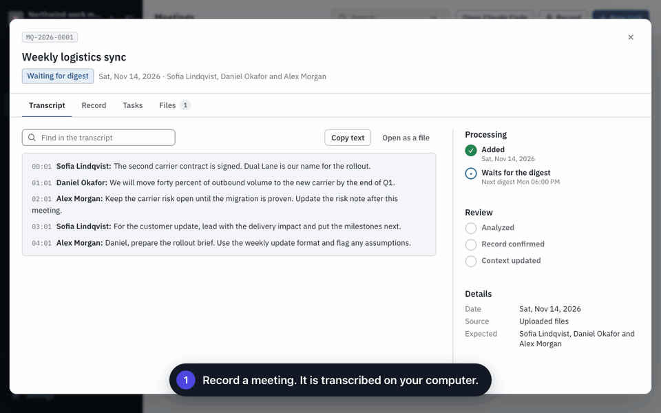

<sub>Real dashboard screens with fictional demo data. The step captions are added for this animation.</sub>

</div>

Get Things Done is an open-source, local-first **work memory** for **Claude Code, Codex and GitHub Copilot**. It keeps how you write, the formats you deliver, the people you work with and what your projects have decided in plain Markdown files. Your AI agent reads them before it writes anything.

**The memory feeds itself.** Every meeting you record adds what changed. Every correction you make to a draft becomes a lesson. You approve each change, so the memory gets better without getting messy, and the next draft needs less explaining and less fixing.

## How it works in a nutshell

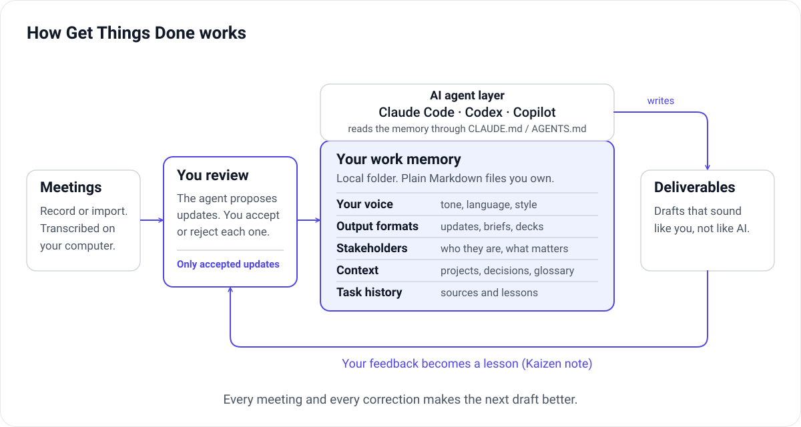

1. **Meetings bring new knowledge in.** Record or import a meeting. It is transcribed on your computer.
2. **You decide what the memory learns.** An agent compares the meeting with what the workspace already knows and proposes a few changes: a new decision, a moved deadline, a new term for the glossary, what a colleague expects. Nothing goes in until you accept it.
3. **The memory is the brain your agent runs on.** Your voice and preferences, output templates, stakeholders, context notes and past tasks are files in one folder. Claude Code, Codex or Copilot reads them through its own instruction file (`CLAUDE.md`, `AGENTS.md` or `.github/copilot-instructions.md`).
4. **Drafts sound like you, not like AI.** The agent writes in your tone and your formats, for what each reader cares about. You review the result and decide when it is done.
5. **Corrections close the loop.** When you send a draft back, the agent records why the first version missed (a Kaizen note). That turns into a proposed fix to the instructions or memory, which you review like any other change.

Less time explaining your work from scratch. More of your context in every first draft.

## Get started

### Desktop app

[**Download for macOS or Windows →**](https://github.com/geovanneb/get-things-done/releases/latest)

Choose the installer for your platform in the release assets. macOS builds are signed and notarized. Windows is currently an unsigned preview; see the release notes before installing. The desktop app includes Git and can capture your microphone and the computer's audio.

### CLI and browser

Requires **Node.js 20.19+**; Node 22 or 24 is recommended.

```bash
npm install -g @bertonha/getthingsdone
mkdir work-memory && cd work-memory
gtd init
gtd start
```

Choose your AI tool during setup. The local dashboard opens in your browser. You can also run `gtd start` first and create a workspace through the setup screen.

**Try the loop:** add one person you work with, write a few lines about your project, then record or import a meeting. Download a speech model in **Settings → Transcription** before transcribing audio. Review the resulting context update and create a task that uses it.

The workspace and offline transcription need no Get Things Done account. AI analysis and task execution use the AI tool you bring; that tool may require its own account or subscription.

The dashboard is available in English, Japanese, Portuguese (Brazil) and Spanish. It follows your system language; change it in **Settings → Appearance → Language**.

> **New in 0.13:** sharing labels on context notes, with only shareable notes going into a shared file or a deliverable for outside readers, a share pack that puts chosen task files into one ZIP, a names and terms check for deliverables, and meetings sent from your iPhone. [See what changed](CHANGELOG.md).

## From meetings to memory to finished work

### 1. Capture the conversation

Record a meeting from the dashboard or desktop menu. Follow a live transcript with a configured live model, or let the app transcribe after the meeting. You can also import transcripts and recordings.

- **Offline speech-to-text:** Whisper and SenseVoice run on your computer after a one-time model download.
- **Microphone and call audio:** desktop captures both on supported systems; Chrome and Edge capture the microphone.
- **Language and speakers:** choose the spoken language and optionally separate voices, then give speaker labels names.
- **A digest when you need it:** collect queued meetings on a schedule or choose **Make digest now**.

Tell everyone before recording; the app asks you to confirm each time. Desktop system audio is supported on Windows and macOS 14.2+.

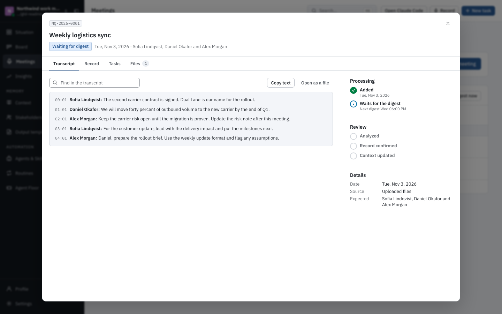

*The transcript shown is an imported fictional example, not a live recording.*

### 2. Review what should become memory

An agent compares the meeting material with what the workspace already knows. It proposes changes to decisions, risks, project context, terminology and stakeholder information. You inspect the evidence and accept or reject the changes.

A conversation can introduce a new deadline, explain what a colleague expects, or change a decision. Those details become useful context for later work **after review**. This is saved context, not model training or automatic fact verification.

Claude Code can analyze and apply updates from the dashboard using your installed CLI and supported sign-in. Optional automatic digest analysis prepares proposals; it does not approve them. Codex and Copilot use the workspace's instructions and files through their own interfaces.

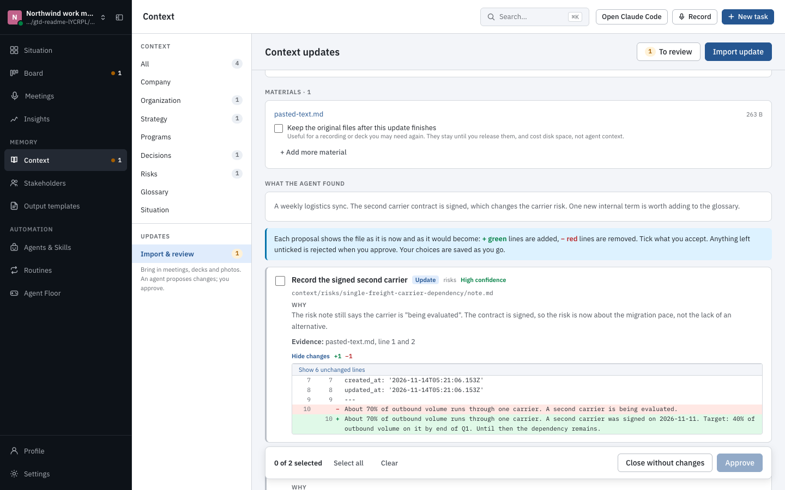

**Keep the evidence useful.** Search meetings by what was said, play retained recordings and jump from transcript timestamps to the audio. Correct a reviewed record through another review. Transcribe a kept recording again with a different model, then choose which transcript version to use. Retention settings let you keep selected meetings longer or move them to the trash.

### 3. Give your agent a task with the background already there

A task connects an objective to the people involved, relevant context and the format you expect. The agent can read how you communicate, what the recipients care about, previous decisions and what a finished deliverable should contain.

For example: *“Draft the project update for the customer, using the latest decision and our weekly update template.”*

With Claude Code, open the workspace and run:

```text
/gtd-task TASK-2026-0001
```

Mention one or several meetings in a task to pin its sources and record the evidence it uses. The task can flag when the meeting record changes later.

The agent writes the deliverable and an execution log, then hands it back for review. **You decide when it is done.** Better context helps the first draft; it does not guarantee an accurate or complete result in one attempt.

Not quite right? Use **Request changes** on the task, or tell the agent in plain words. It reworks the draft and writes a Kaizen note on why the first version missed. The note opens a context update, so the fix lands in the instructions or the memory after your review, and the same mistake is less likely next time.

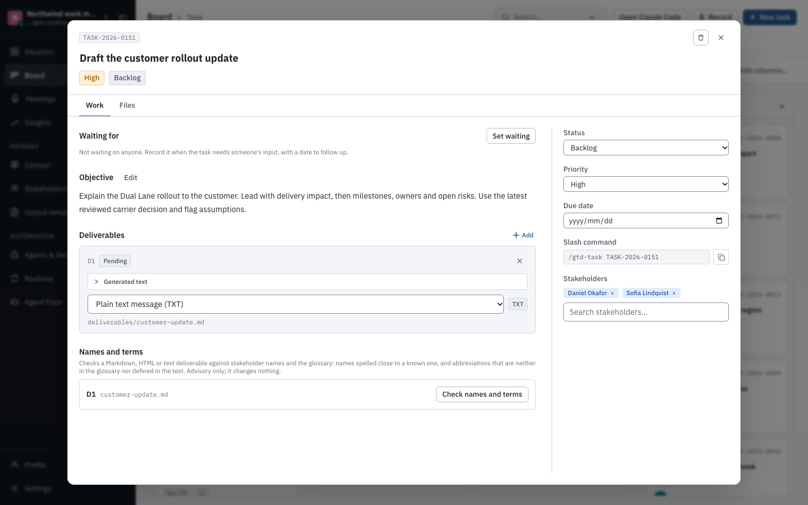

## What your AI can remember

| Memory | Why it helps |
| --- | --- |
| **Your voice and working style** | Tone, language, how you decide, responsibilities and recurring expectations |
| **People and relationships** | Who is involved, what matters to them and how to communicate with them |
| **Projects and decisions** | Current plans, risks, agreements, the reasons behind them and a glossary of your terms |
| **Meeting context** | Searchable transcripts, confirmed records and reviewed corrections, with retention you control |
| **Output templates** | The structure and style of updates, briefs, documents and decks you deliver repeatedly |
| **Task history and lessons** | Deliverables, sources, assumptions, your feedback and the Kaizen lessons drawn from it |

Useful for developers coordinating projects, consultants working with clients, founders, project leads and anyone whose work depends on remembering what people agreed to.

## Files you own, tools you choose

The workspace is a folder of Markdown and YAML frontmatter, with attachments and recordings alongside it. There is **no database service to set up**. An optional local SQLite search index is derived from the files; the files remain the source of truth.

```text
work-memory/
├── profile/          Your working style and preferences
├── stakeholders/     People, organizations and expectations
├── context/          Projects, decisions, risks and terminology
├── context-updates/  Material and proposed memory changes
├── meetings/         Retained recordings and transcript versions
├── outputs/          Reusable deliverable templates
└── tasks/            Objectives, deliverables and execution logs
```

| Tool | Integration |
| --- | --- |
| **Claude Code** | Workspace instructions, commands and specialist agents; dashboard analysis/apply runner |
| **Codex** | `AGENTS.md` with the workspace conventions |
| **GitHub Copilot** | `.github/copilot-instructions.md` with equivalent guidance |
| **Other agents** | Read the files and follow the conventions; compatibility depends on the tool |

The app does not require an MCP server or proprietary memory API. You can inspect the files, edit them, back them up and change agents. The dashboard adds a task board, meeting workflow, search, review and insights over the same workspace.

<details>
<summary>See the meetings, task board, stakeholders and progress views</summary>

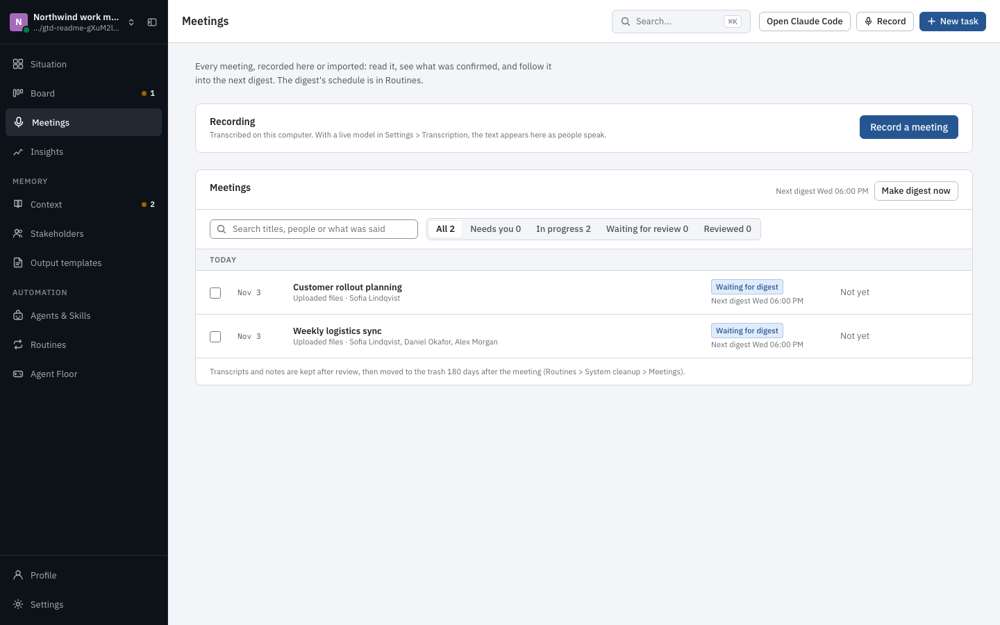

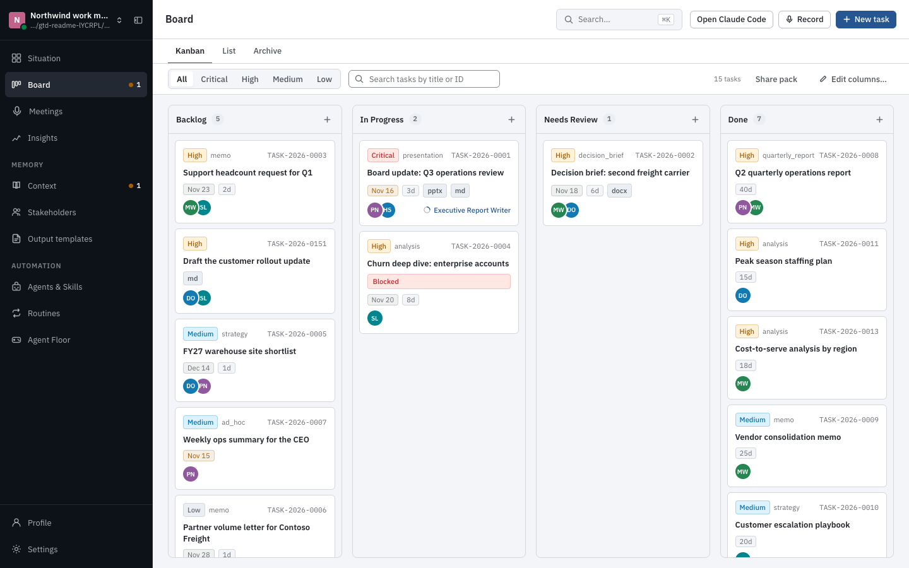

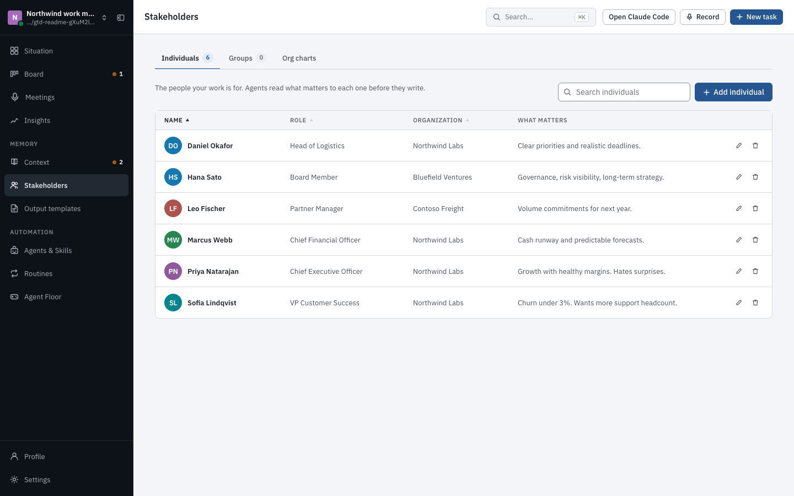

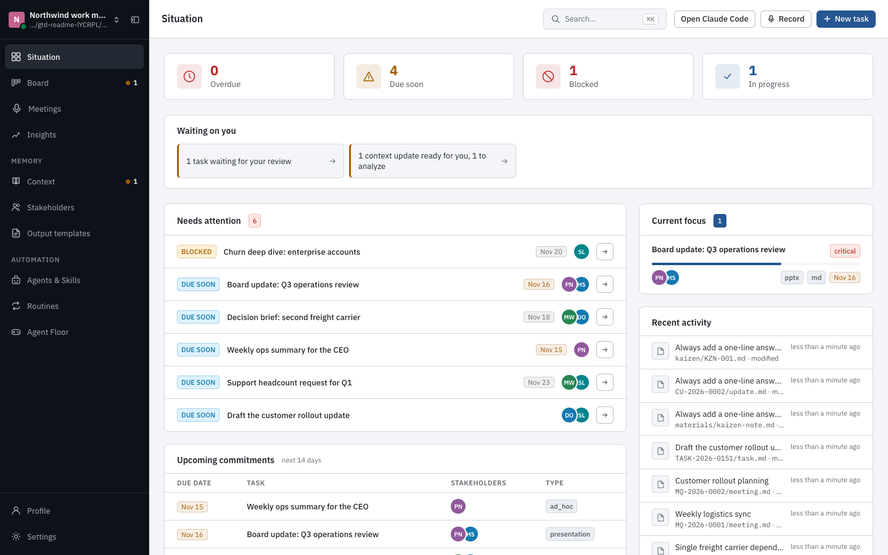

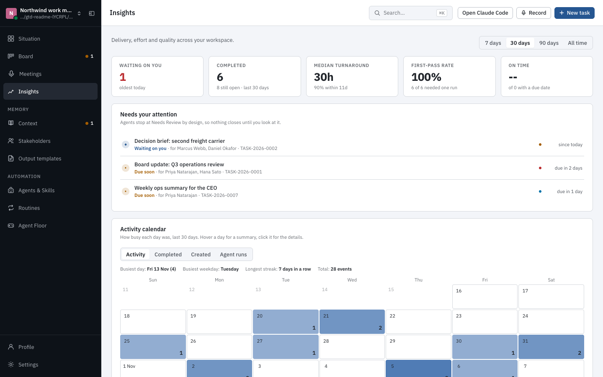

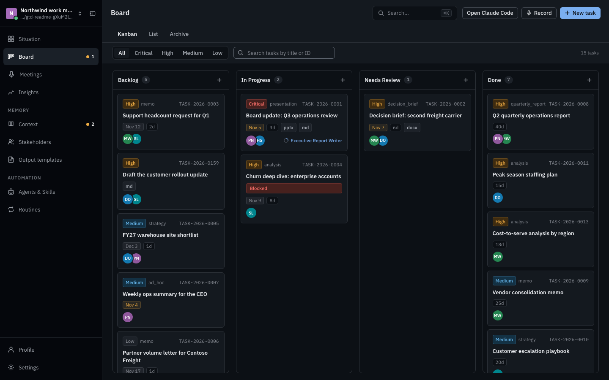

The optional **Agent Floor** visualizes agents working through tasks:

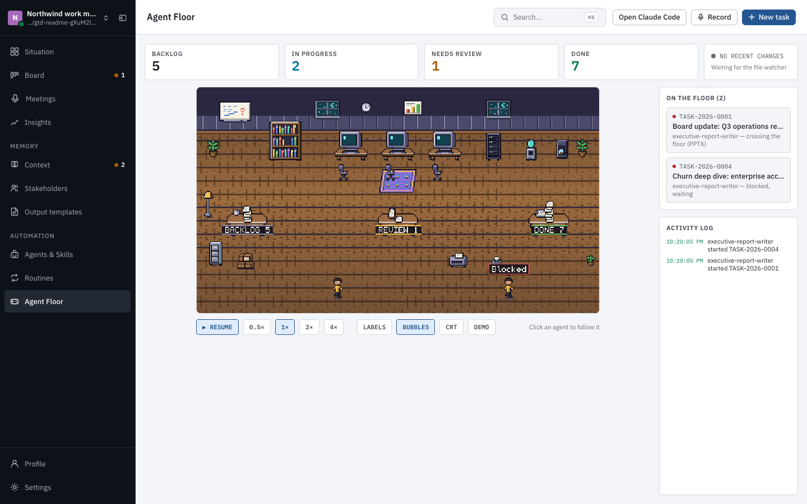

All people, organizations, conversations and numbers in these screenshots are fictional.

</details>

## Privacy and control

- **Local storage and transcription.** The dashboard binds to `127.0.0.1`; audio transcription happens on your computer after downloading models.
- **Cloud agents have their own data boundary.** When you run a task or analysis with a cloud AI tool, material that tool reads can be sent to its provider. Automatic digest analysis, if enabled, also invokes that tool.
- **Review before applying.** Proposed memory changes need your approval. Agents hand deliverables back for review.
- **Network access is explicit in the workflow.** Model and sample downloads, skill installation and desktop update checks use the network. The app has no telemetry service.
- **Back up your workspace.** Retention settings can remove recordings and transcripts. Use a private repository for work notes, and a separate backup for files excluded from Git.

See the [user guide](docs/user-guide.md#version-control-and-privacy) and [security policy](SECURITY.md) for details. Local storage is not encryption or an agent sandbox.

## Documentation and contributing

- [User guide](docs/user-guide.md): setup, recording, transcription, context review and task execution
- [CLI commands](docs/user-guide.md#command-reference) · [Workspace layout](docs/user-guide.md#workspace-layout) · [Upgrading](docs/user-guide.md#upgrading)
- [HTTP API](docs/api.md) · [Architecture](docs/architecture.md) · [Desktop development](desktop/README.md)
- [Changelog](CHANGELOG.md) · [Troubleshooting](docs/user-guide.md#troubleshooting)
- [Contributing](CONTRIBUTING.md) · [Discussions](https://github.com/geovanneb/get-things-done/discussions) · [Report a bug](https://github.com/geovanneb/get-things-done/issues)

Contributions to agent integrations, meeting workflows, documentation and accessibility are welcome. Use fictional data in issues and examples. Report security issues privately through [SECURITY.md](SECURITY.md).

**If this fits how you want to work with AI, star the repository to find it again.** Try a small workspace and tell us what helped, or what context was still missing.

MIT licensed. See [LICENSE](LICENSE).
