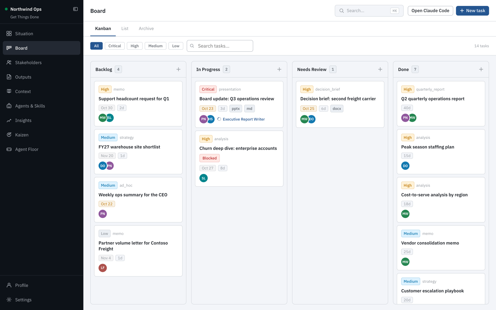
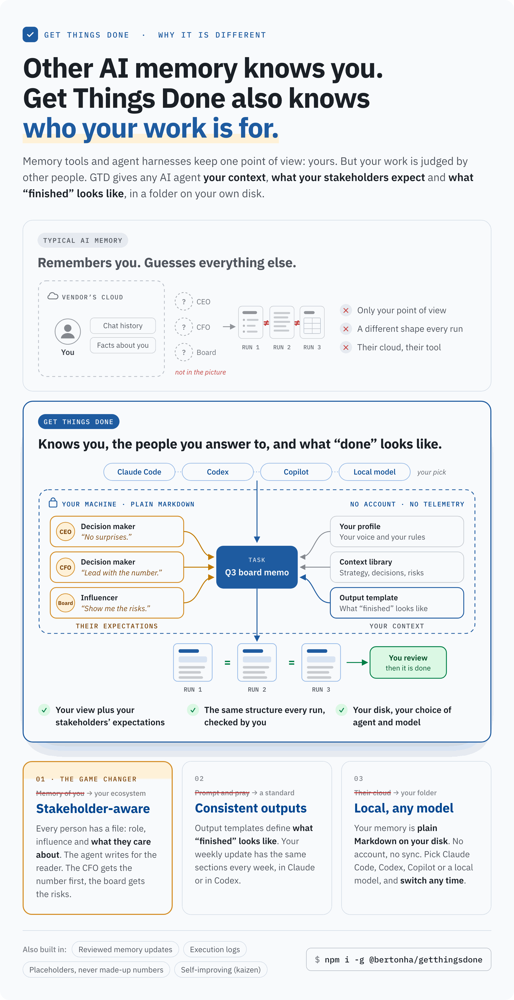
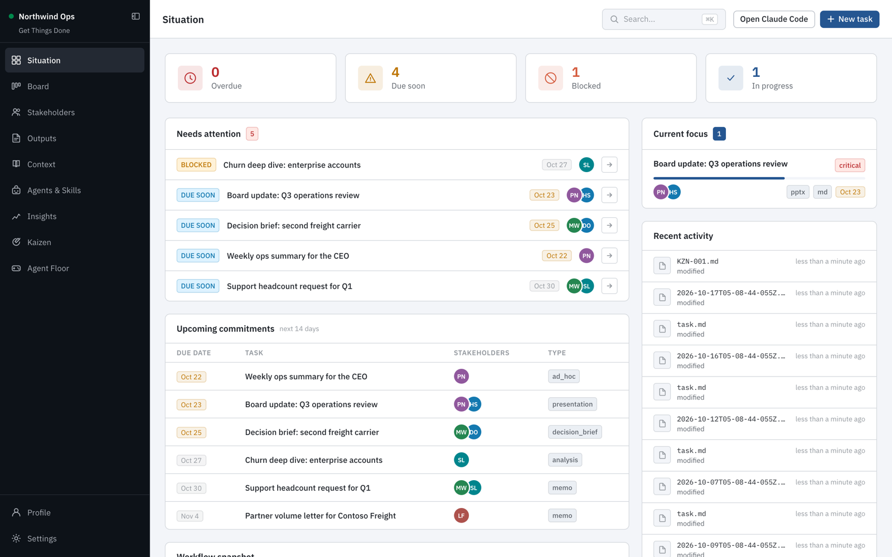
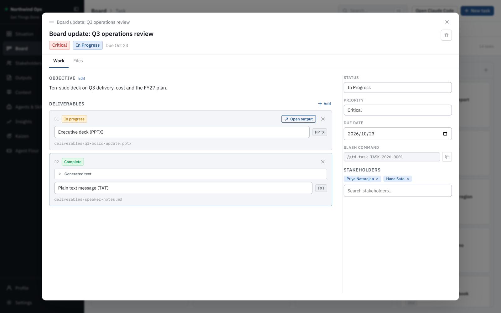
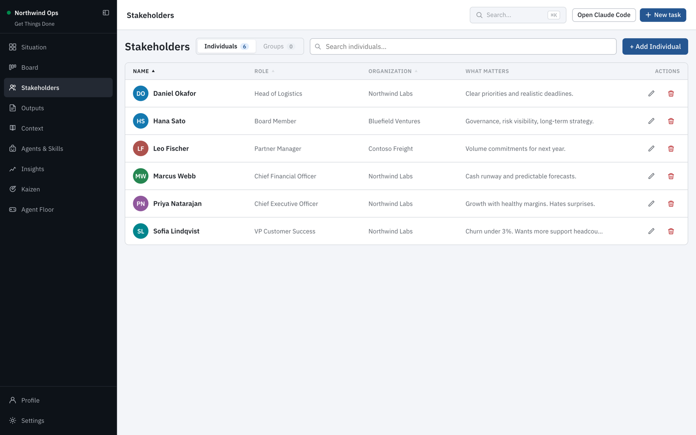
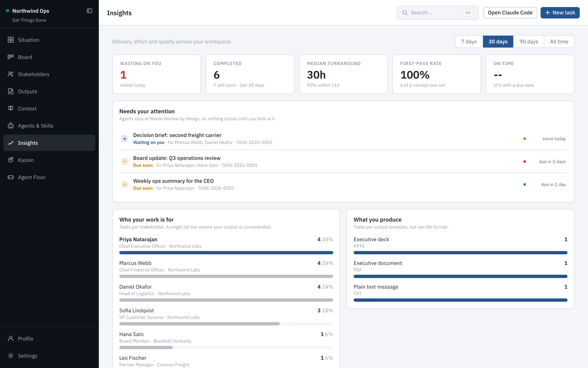
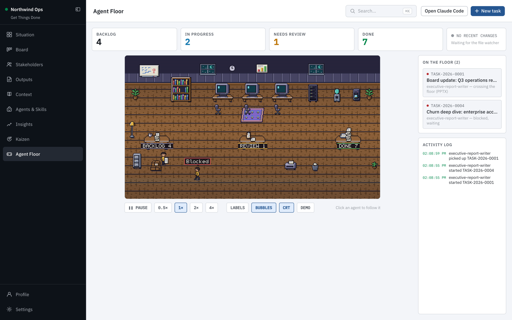
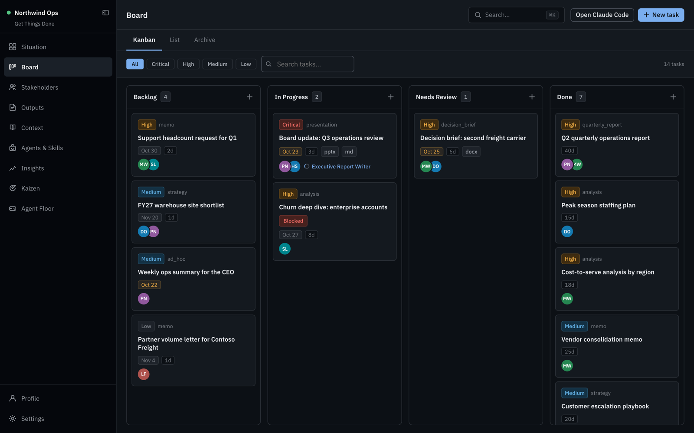

<div align="center">

# Get Things Done

**Your executive workload, as plain Markdown files your AI can actually work with.**

[](https://www.npmjs.com/package/@bertonha/getthingsdone)
[](https://github.com/geovanneb/get-things-done/actions/workflows/ci.yml)
[](LICENSE)
[](https://nodejs.org)

[](https://youtu.be/v0GaoY16CU0)

<sub>Watch the 40-second demo on YouTube.</sub>



<sub>All names, companies and numbers in this video and these screenshots are fictional.</sub>

</div>

---

## The pitch

You are an executive. Your day is tasks, people, context and deliverables, and all
four live in different places: a task in your head, the political situation in your
memory, the strategy in a deck somewhere, the actual document due tomorrow in a tab
you have not opened yet.

AI assistants should fix this. Mostly they do not, because every conversation starts
from nothing. You re-explain who your CFO is, how your CEO likes to be briefed, what
last quarter's decision was, what your house style looks like. By the time the
context is loaded, you could have written the thing yourself.

**Get Things Done gives your AI a memory of your job.**

It turns a folder on your machine into a structured executive workspace: your
profile, your stakeholders, your context library, your output templates and your
tasks. A local kanban dashboard lets you run it like a board. And because everything
is plain Markdown in a folder you own, Claude Code, GitHub Copilot and Codex read the
exact same files you do.

Ask for a board memo and the agent already knows who the board is, how you write,
which strategy note applies, and what a finished memo looks like. It writes the
deliverable into the task folder, logs what it did and what it assumed, and marks it
for your review. It never marks its own work done. That stays your call.

**Nothing leaves your machine.** The server binds to `127.0.0.1`. Your content is a
folder of Markdown files you can back up, move, or put in a private git repo. No
account, no cloud, no telemetry.

```bash
npm install -g @bertonha/getthingsdone
mkdir my-workspace && cd my-workspace
gtd init
gtd start
```

Prefer clicking to typing? Run `gtd start` without `gtd init`: the dashboard opens a short setup
screen that creates the workspace for you.

---

## Why it is different

<div align="center">

</div>

AI memory is everywhere now. Chat apps remember your conversations. Memory layers
remember facts about your users. Note tools plugged in over MCP hand your notes to an
agent. Every one of them answers the same question: **who are you?**

That is only half of the job. Your work is not judged by you. It is judged by a CEO
who hates surprises, a CFO who wants the number in the first line, and a board that
reads for risk. An assistant that only knows you writes a good memo for you, and the
wrong memo for them.

Get Things Done is built around the other half.

**It knows who your work is for.** Every stakeholder has a file: their role, their
influence and what actually matters to them. Org charts show who reports to whom.
Before an agent writes anything, it reads every person on the task and pitches the
result at the most senior reader. No mainstream memory tool models this, and it is
the part that decides whether your work lands.

**It knows what "finished" looks like.** Ask an AI the same thing twice and you get
two different shapes. That is fine for brainstorming and painful for real work.
Output templates fix the format, the sections and the style of the things you deliver
again and again. Your weekly update looks like your weekly update, every week, no
matter which agent wrote it.

**Your memory stays yours.** Everything is plain Markdown in a folder on your disk:
not in a vendor's account, not behind an API, not quietly rewritten in the background.
You choose the agent and the model: Claude Code, Codex, Copilot, or a local model so
nothing leaves your machine at all. Switch tomorrow and you lose nothing.

**You stay in charge.** The agent never marks its own work done. It logs what it did
and what it assumed, and it leaves a clear placeholder instead of inventing a number.
When a meeting changes the facts, the update arrives as a diff you accept or reject,
never as a silent edit.

| | Chat app memory | Memory layers | Notes over MCP | **Get Things Done** |
|---|:---:|:---:|:---:|:---:|
| Remembers you and your context | ✅ | ✅ | ✅ | ✅ |
| Knows what each stakeholder expects | ❌ | ❌ | ❌ | ✅ |
| Defines what a finished deliverable looks like | ❌ | ❌ | ❌ | ✅ |
| Memory is readable files on your disk | ❌ | ❌ | ✅ | ✅ |
| Works with any agent, including local models | ❌ | Via SDK | Via MCP | ✅ No plugin |
| You approve every change to memory | ❌ | ❌ | ❌ | ✅ |

<sub>Chat app memory: ChatGPT, Claude.ai. Memory layers: Mem0, Zep, Letta.
Notes over MCP: Basic Memory, Obsidian MCP servers. Based on their public
documentation as of October 2026; corrections are welcome.</sub>

> Other tools give your AI a memory. Get Things Done gives it a job description, a
> list of people to win over, and a definition of done.

When you use a cloud model, the agent sends what a task needs to that provider while
it runs, as any AI tool does. Your workspace itself never moves: no sync, no account,
no telemetry.

---

## Why files, not another app

Every SaaS task tool is a walled garden with an API you have to beg for. This is a
folder.

- **Your AI reads it natively.** No plugin, no MCP server, no integration. Point
  Claude Code at the folder and it works.
- **It outlives the tool.** Markdown and YAML frontmatter will open in thirty years.
- **You own the backup story.** `git init`, Time Machine, Dropbox, whatever you already trust.
- **You can grep it.** Because sometimes that is genuinely the fastest thing.

The dashboard is a convenience over the files, not a prison around them. Delete the
app and you still have everything.

---

## A quick tour

**Situation** is your morning view: what is overdue, blocked or due soon, what you
are focused on, and what changed in the workspace.



**Tasks** carry the objective, the stakeholders, the deliverables and the output
template they follow. Copy the `/gtd-task` command and hand it to your AI agent.



**Stakeholders** record who people are and what matters to them, so agents write to a
CFO differently than to a partner.



**Context updates** keep your context true as things change. Drop in a meeting
transcript, a deck or a photo of a whiteboard; an agent proposes only the changes that
matter, and you accept or reject each one as a before and after diff.
[How it works](#keeping-context-up-to-date).

**Insights** show what is waiting on you, how long work takes, and who your work is
really for.



**Agent Floor** is an optional pixel-art view of your agents picking up, working on
and handing in tasks. Turn it on under Settings.



Light and dark themes are built in.



---

## Table of contents

- [A quick tour](#a-quick-tour)
- [Install](#install)
- [Your first workspace](#your-first-workspace)
- [Core concepts](#core-concepts)
- [Running a task with an AI agent](#running-a-task-with-an-ai-agent)
- [Keeping context up to date](#keeping-context-up-to-date)
- [Command reference](#command-reference)
- [Workspace layout](#workspace-layout)
- [What is yours and what is the app's](#what-is-yours-and-what-is-the-apps)
- [Upgrading](#upgrading)
- [Version control and privacy](#version-control-and-privacy)
- [Configuration](#configuration)
- [Troubleshooting](#troubleshooting)
- [Development](#development)
- [Contributing](#contributing)
- [License](#license)

---

## Install

Requires **Node.js 20.19 or newer** (22 or 24 recommended).

```bash
npm install -g @bertonha/getthingsdone
```

This installs the `gtd` command globally. The application lives in your global
`node_modules`; your workspaces hold only your content.

Verify:

```bash
gtd --version
```

---

## Your first workspace

Create a folder and initialize it:

```bash
mkdir ~/executive-workspace
cd ~/executive-workspace
gtd init
```

`gtd init` asks five questions:

| Question | What it is used for |
|---|---|
| Workspace name | Shown in the dashboard header |
| Your name | Written into your executive profile |
| Your role/title | Helps agents calibrate tone and altitude |
| Organization | Interpolated into agent instruction files |
| AI tools | Which assistant integrations to install |

Then start the dashboard:

```bash
gtd start
```

It opens <http://localhost:3001> in your browser and keeps running in the
background. Close the terminal; it stays up. `gtd stop` when you are done.

### Scripted setup

For dotfiles, containers or CI, skip the prompts entirely:

```bash
gtd init --yes \
  --name "Jane Doe" \
  --role "Chief Technology Officer" \
  --org "Acme Corp" \
  --workspace-name "Acme Executive Workspace" \
  --ai claude-code,codex
```

`--yes` also engages automatically when stdin is not a TTY.

---

## Core concepts

Five things make up the system. Get these right and the AI output gets dramatically
better.

### 1. Your profile — `profile/executive-profile.md`

Who you are and how you communicate. Every agent reads this before writing anything.
Fill in the sections honestly: **Responsibilities**, **Communication Style**,
**Decision Making**, **Language Preferences**, **Recurring Expectations**,
**Principles**.

This is the single highest-leverage file in the workspace. "Direct, no hedging, lead
with the ask, never use em dashes, Japanese business context so use -san" produces
visibly different output than an empty profile.

### 2. Stakeholders — `stakeholders/people/`

One file per person: their role, organization, influence level, and what actually
matters to them. Influence level drives how agents write to them:

| Influence | How agents adapt |
|---|---|
| `decision_maker` | Brief, direct, leads with the ask, one page |
| `influencer` | Acknowledges their perspective first, invites input |
| `informed` | Summary only, no unrequested detail |
| `executor` | Clear action, timeline, owner, no ambiguity |

**Org charts** (`stakeholders/org-charts/`) map who reports to whom inside a company or
organization. Build them in **Stakeholders → Org charts** by dragging people onto their
manager. Agents read the charts for every stakeholder on a task, so a deliverable is
pitched at the most senior person involved and names the right escalation path.

**Prepare meeting** on a person's page opens the New task form already filled in: the
person as stakeholder, a **Meeting brief** output and the `meeting-prep` agent (when the
workspace has them). Add the other attendees, the meeting date and your goal, then save.
Nothing runs until you start the task.

### 3. Context — `context/`

Your background knowledge library, filed by category: `company/`, `organization/`,
`strategy/`, `programs/`, `decisions/`, `risks/`, `glossary/`, `situation/`.

Agents scan the whole library, not just what a task lists. Put the strategy deck
summary, the risk register, the org chart, the acronyms your company invented. This
is the memory you stop having to repeat.

Context goes stale as things change. Instead of editing notes by hand after every
meeting, import the material and let an agent propose the updates for you to review.
See [Keeping context up to date](#keeping-context-up-to-date).

### 4. Output templates — `outputs/templates/`

What "finished" looks like. Each template declares a format, required sections and a
style guide. Four ship by default: **Plain text message**, **Executive document**,
**Executive deck** and **Meeting brief**. Create your own for the artifacts you produce over and over —
your weekly update, your steering committee pack, your board memo.

### 5. Tasks — `tasks/active/`

The unit of work. A task links the other four together:

```
tasks/active/TASK-2026-0001/
  task.md            objective, stakeholders, contexts, deliverables
  deliverables/      what the agent produces
  executions/        what it did, what it assumed, what it could not find
  attachments/       source material you provide
  notes/
```

Tasks move `backlog` → `in_progress` → `in_review` → `done`. Agents set
`in_progress` when they pick work up and `in_review` when they finish. **Only you set
`done`**, and only after reading the output.

---

## Running a task with an AI agent

Create a task in the dashboard, attach the stakeholders and contexts that matter,
pick an output template. Then from your workspace folder:

```bash
claude
```

Claude Code loads `CLAUDE.md` automatically. Run the task:

```
/gtd-task TASK-2026-0001
```

The agent will, in order:

1. Set the task to `in_progress`
2. Read your executive profile
3. Read the task definition
4. Read every stakeholder listed on it
5. Scan the full context library for anything relevant
6. Read the output template for each deliverable
7. Produce the deliverable into `deliverables/`
8. Set the task to `in_review`
9. Write an execution log recording decisions, sources and any placeholders

Where data is missing, agents insert explicit placeholders rather than inventing
figures:

```
[PLACEHOLDER: Q3 revenue from Finance - owner: Sam Rivera - by: 2026-09-05]
```

A complete structure with marked gaps beats a partial document.

### Specialist agents

Four ship with the Claude Code integration and are selected via a task's
`preferred_agent` field:

| Agent | Use for |
|---|---|
| `executive-report-writer` | Reports, decks, memos, strategic documents |
| `stakeholder-advisor` | Sensitive comms, influence mapping, politics |
| `context-researcher` | Research and context notes (writes context, not deliverables) |
| `meeting-prep` | Briefs, talking points, likely questions, red lines |

### Skills

Five curated skills ship by default: `decision-brief`, `financial-analysis`,
`presentations`, `risk-analysis`, `stakeholder-communication`. More can be installed
from the Anthropic skills marketplace inside the dashboard's Agents view.

### Other assistants

Selecting `copilot` or `codex` at init writes `.github/copilot-instructions.md` or
`AGENTS.md` with equivalent guidance. Same files, same conventions.

---

## Keeping context up to date

Your context is only useful while it is true. A reorg announced in a meeting, a new
target on a slide, a decision made in a hallway: each one makes some note out of date,
and every task produced from that note gets a little worse.

**Context updates** turn that raw material into a few reviewed changes. You bring the
material, an agent does the reading and comparing, and you decide what goes in.

The rule behind the whole feature: **never change just to change.** The agent distils
the material into the few edits that keep your context true. One meeting usually
justifies one or two changes, and "nothing worth changing" is a normal result.

### How it works

| Step | Who | What happens |
|---|---|---|
| 1. Collect | You | Upload files or paste a transcript in the dashboard |
| 2. Analyze | Agent | `/gtd-context-analyze CU-…` reads the material against your whole context and proposes changes |
| 3. Review | You | Accept or reject each proposal, shown as a before and after diff |
| 4. Apply | Agent | `/gtd-context-apply CU-…` writes only what you accepted, then cleans up |

Nothing in `context/` or `stakeholders/` changes until step 4, and only for the
proposals you ticked.

### 1. Collect

Open **Context** and click **Import update** (or **Import & review** in the sidebar,
under the categories). Then add:

- **Files**, as many as you like, in any format: transcripts, slides, PDFs,
  spreadsheets, photos, screenshots. Up to 50 MB each.
- **Pasted text**, for a transcript copied from your meeting tool, notes or an email
  thread. It is saved as a file with the rest.

A **WebVTT transcript** (`.vtt`, the export of Teams, Zoom or Meet, uploaded or pasted)
also gets a readable copy next to it, `<name>.transcript.md`: each turn with its start
and end time and the speaker as the file labels it, every word kept. Anything the
dashboard cannot read is listed in the copy, which then says it is incomplete. The
original stays, and the update records which file is a copy of which, so the agent
reads the copy and removing an original removes its unchanged copy. If the original or
the copy is edited afterwards, the copy is marked outdated and the agent reads the
original. To make a copy
again, remove the original and add it again. The same file twice in one update is
refused.
- **Date of the material**: when the meeting happened or the deck was shared, not
  today. The agent uses it to tell newer facts from older ones, so an old deck never
  overwrites something more recent.
- **Notes for the agent** (optional): what this is, who was there, what to trust or
  ignore. For example: "Budget figures are a first draft."

Save, and the update gets an ID such as `CU-2026-0001` and the command to run next.
Put everything about one event (the transcript, the deck and the follow-up email) in
one update, so the agent reads them together.

### 2. Analyze

From your workspace folder, start your agent and paste the command the dashboard
shows:

```
/gtd-context-analyze CU-2026-0001
```

The agent reads every file, then your whole context library, your stakeholders and
org charts, and your profile. A fact becomes a proposal only when it is:

- **Durable:** still true and useful in a few weeks. Meeting logistics and small talk
  are not.
- **Consequential:** a deliverable written next week would be wrong or weaker
  without it.
- **New or different:** not already in your context in substance. Rewording is not a
  change.
- **Grounded:** it can point to where the fact appears in the material. Rumours are
  skipped, or recorded clearly as unconfirmed.
- **Not older than what is there:** older material only fills real gaps.

It prefers updating an existing note to creating a new one, makes one proposal per
file, and keeps edits small: your structure, headings and wording stay. Every proposal
comes with a reason, evidence (for example "transcript.txt, around 00:14" or
"deck.pptx, slide 6") and a confidence level. Contradictions with your current
context are called out, never silently overwritten.

When the material is from meetings, it also drafts a short **meeting record** per
meeting: the date, who attended (linked to your stakeholders where it is sure, the
name as written otherwise), decisions, open questions and action items. A record is
not a context change, so it does not need a file.

It also lists what it **considered but did not propose**, with the reason, so you can
see the filter at work. Files it could not read (audio, video, encrypted files) are
listed too, instead of being guessed at.

The dashboard updates by itself while the agent works.

### 3. Review

Open the update. Each proposal shows:

- the file it creates or changes, and whether it is a new file or an update
- why it matters, the evidence and the confidence
- a diff of the file as it is now and as it would become: **+ green** lines are
  added, **− red** lines are removed

Tick the proposals you accept. Your choices are saved as you go, so you can leave and
come back. If a proposal is almost right, accept it and add a **note for the agent**,
such as "keep the old title" or "say this is still a draft".

Meeting records are reviewed on their own: **Confirm** a record that is right, or
**Reject** it. A confirmation is for the exact text you saw: if the record changes
afterwards, it needs confirming again before you can approve or close. A record that
is malformed or too long to show in full says why, and can only be rejected until the
agent fixes it.

Once the update is done, each action item of a confirmed record has **Create task**: it
opens the New task form filled in from the item (title, where it comes from, the due
date, and the owner as stakeholder when the record's name is that stakeholder's name).
Nothing is created until you save. Saving creates the task and links the item to it in
one step, so the same item never becomes two tasks, even from two windows. Agents never
create tasks from action items themselves. You can confirm a meeting that changes nothing in your context, and an
update with only confirmed records finishes as soon as you approve it. Confirmed
records stay with the update after it is done, and System cleanup never removes an
update that has one. A record you did not confirm is rejected when you approve or
close.

When you are done, click **Approve N selected**. Anything left unticked is rejected and
your selection is locked. Changed your mind before applying? **Change my selection**
takes you back. If nothing is worth taking, **Close without changes** finishes the
update without touching any file.

If a file was edited after the analysis, the proposal says so. The diff is then shown
against the current version, and when applying the agent merges instead of
overwriting the newer edits.

### 4. Apply

Run the second command the dashboard shows:

```
/gtd-context-apply CU-2026-0001
```

The agent writes only the accepted proposals, following your notes, and records an
outcome for each one: applied, merged with newer edits, or failed with a reason. Then
the update is **Done**. Its record stays (the summary, the list of materials, every
proposal with your decision and its outcome), while the uploaded files and drafts are
deleted, so the workspace does not grow over time.

### Statuses

| Status | Meaning | What you do |
|---|---|---|
| Run the analyze command | Material saved | Run `/gtd-context-analyze` |
| Agent is analyzing | The agent is reading | Wait; the page refreshes by itself |
| Ready for your review | Proposals are in | Tick what you accept, then approve |
| Approved: run the apply command | Selection locked | Run `/gtd-context-apply` |
| Agent is applying | The agent is writing | Wait |
| Done | Finished | Nothing; the record stays as history |

The sidebar shows how many updates are waiting on you, and **Context** in the main
navigation shows a badge when proposals are ready for review.

### Common questions

**The agent found nothing to change.** That is a normal result: not every meeting
changes what is true. Click **Close update**.

**I have more material after the analysis.** Click **Add more material**. The update
goes back to collecting and the old proposals are discarded, so the next analysis
looks at everything together.

**The agent stopped half way.** Run the same command again. It picks up where it left
off. While analyzing, you can also go back to collecting.

**I uploaded audio or video.** The dashboard warns you, because the agent may not be
able to read it. Upload a transcript too.

**Something was left out that should be in my context.** Check **Considered but not
proposed** for the reason. Add a note and analyze again, or edit the note yourself.

**Can an update change any file?** No. Proposals can only target context notes
(`context/<category>/…/note.md`) and stakeholder, group or org chart files. The agent
treats instructions inside the material as content, not as commands.

**Where are the files?** In `context-updates/CU-YYYY-NNNN/`: `update.md` (the record),
`materials/` (your uploads) and `proposals/` (the drafts the diffs are built from).
This folder sits outside `context/` on purpose: agents writing tasks never read raw
transcripts as if they were reviewed context.

**I use Codex or Copilot.** They have no slash commands, so ask in plain words:
"analyze context update CU-2026-0001", then "apply context update CU-2026-0001". The
workspace instructions (`AGENTS.md`, `.github/copilot-instructions.md`) describe the
same steps.

---

## Command reference

| Command | Description |
|---|---|
| `gtd init` | Create a workspace in the current directory |
| `gtd start` | Start the dashboard in the background |
| `gtd stop` | Stop the dashboard |
| `gtd status` | Show whether it is running, on which port, against which workspace |
| `gtd open` | Open the dashboard in your browser |
| `gtd upgrade` | Refresh app-provided files after updating the package |
| `gtd use <path>` | Point the dashboard at a different workspace |

### `gtd init`

| Flag | Description |
|---|---|
| `-d, --dir <path>` | Target directory (default: current) |
| `-y, --yes` | Accept defaults, skip all prompts |
| `--name <name>` | Your name |
| `--role <role>` | Your role or title |
| `--org <organization>` | Your organization |
| `--workspace-name <name>` | Workspace display name |
| `--ai <tools>` | Comma-separated: `claude-code,copilot,codex` |

### `gtd start`

| Flag | Description |
|---|---|
| `-p, --port <number>` | Port to listen on (default 3001) |
| `--no-open` | Do not open a browser |
| `-f, --foreground` | Run attached instead of in the background |

If the port is busy, it picks the next free one and tells you. Logs go to
`.situation-board/logs/server.log` in your workspace.

### `gtd upgrade`

| Flag | Description |
|---|---|
| `-d, --dir <path>` | Workspace to upgrade (default: the configured one) |

---

## Workspace layout

```
my-workspace/
├── CLAUDE.md                  Instructions your AI agent reads first
├── README.md                  This workspace's own quick reference
├── workspace.yaml             Name, settings, path map
├── .gitignore
│
├── .claude/                   Claude Code integration
│   ├── agents/                4 specialist agents
│   ├── commands/              /gtd-task, /gtd-kaizen, /gtd-context-analyze, /gtd-context-apply
│   ├── skills/                5 curated skills
│   └── settings.json          Tool permissions (read-wide, write-narrow)
│
├── .schemas/                  JSON Schemas for every file type
├── .situation-board/          App state: cache, logs, trash, manifest
│
├── profile/
│   └── executive-profile.md   Your voice and preferences
│
├── stakeholders/
│   ├── people/                STK-NNNN.md
│   └── groups/                GRP-NNNN.md
│
├── tasks/
│   ├── active/                One folder per task
│   └── archive/
│
├── context/                   Your knowledge library
│   ├── company/  organization/  strategy/  programs/
│   └── decisions/  risks/  glossary/  situation/
├── context-updates/           Imported material and what it changed
│
├── outputs/templates/         What "finished" looks like
├── kaizen/                    Improvement proposals
└── workflows/                 Reserved for multi-step workflows
```

Deletes are soft. Removing a file in the dashboard moves it to
`.situation-board/trash/` with a timestamp, and every overwrite keeps the previous
version there too.

### Cleanup and retention

A built-in **System cleanup** routine (Routines page, settings in
`.situation-board/routines/system-cleanup.json`) keeps the workspace tidy. Out of the
box it runs every Monday at 09:00 and only suggests: it scans your context notes and
stakeholders for duplicates, empty and old notes, and opens a context update tagged
**System cleanup**. Run `/gtd-context-analyze` on it, and the agent proposes merges,
moves and removals for you to approve. Approved removals go to the trash.

It never archives, trashes or deletes a file until you turn a rule on. Per type
(finished tasks, archived tasks, finished context updates, closed kaizen proposals,
the trash itself) you choose the age in days and the action: archive, move to trash
or delete permanently. A preview shows exactly what a run would do before you save.
Tasks tagged `keep` are never touched, nor are context updates whose materials you kept
or that hold a confirmed meeting record, and a run handles at most 200 items.

---

## What is yours and what is the app's

This is worth understanding, because it is what makes upgrades safe.

**App-provided** — ships with the package, refreshed on `gtd upgrade`:

```
CLAUDE.md    README.md    .gitignore    .schemas/
.claude/     (agents, commands, skills, settings)
outputs/templates/plain-text, executive-document, executive-deck, meeting-brief
```

**Yours** — created through the dashboard or by hand, never touched:

```
tasks/    stakeholders/    context/    context-updates/    kaizen/    workflows/
profile/executive-profile.md
outputs/templates/<anything you made>
.claude/skills/<anything you installed from the marketplace>
```

### How the app tells them apart

Not by folder — `outputs/templates/` and `.claude/skills/` legitimately hold both
kinds, and you may well want to edit `CLAUDE.md` yourself.

Instead the app records a SHA-256 of every file it installs in
`.situation-board/app-manifest.json`. On upgrade, for each app-provided file:

| Situation | What happens |
|---|---|
| File is missing | Installed |
| Hash still matches the manifest | You never touched it — replaced silently |
| Hash differs | **You edited it.** Yours is kept; the new version is written as `<file>.new` |

So customize `CLAUDE.md` freely. You will never lose your changes, and you will never
be stuck on an old version without knowing it. `gtd upgrade` prints exactly which
files fell into which bucket.

---

## Upgrading

```bash
npm update -g @bertonha/getthingsdone
gtd stop
gtd upgrade
gtd start
```

`gtd upgrade` operates on the configured workspace. If you keep several, run it in
each with `-d`:

```bash
gtd upgrade -d ~/work-workspace
gtd upgrade -d ~/board-workspace
```

---

## Version control and privacy

A workspace is a plain folder of Markdown, so git works well:

```bash
cd my-workspace
git init
git add .
git commit -m "Initial workspace"
```

The generated `.gitignore` already excludes caches, logs and trash.

> **Use a private repository.** Stakeholder files contain real names, influence
> assessments and political notes. Context notes contain strategy and risk registers.
> Deliverables contain whatever you asked for. This is exactly the material that
> should not be public.

The application never transmits your content. The server binds to `127.0.0.1` only.
The single outbound call it can make is when you explicitly install a skill from the
Anthropic marketplace in the Agents view.

---

## Configuration

Global config lives at `~/.gtd/config.json`:

```json
{
  "workspace_path": "/Users/you/executive-workspace",
  "port": 3001
}
```

| Environment variable | Effect |
|---|---|
| `ESB_WORKSPACE_PATH` | Override the workspace path (takes precedence over config) |
| `PORT` | Override the port |

Switching between workspaces:

```bash
gtd use ~/other-workspace
gtd start
```

In the dashboard, click the workspace name at the top of the sidebar. It lists the
workspaces you opened on this machine (kept in `recent_workspaces` in the config file),
so switching back is one click. **Open another folder...** adds a new one. Removing an
entry from the list never touches the folder.

---

## Troubleshooting

**`gtd start` says the port is in use.**
It automatically moves to the next free port and prints which one. Pin it with
`-p 4000` if you prefer.

**The dashboard will not start.**
Check `.situation-board/logs/server.log` in your workspace — `gtd start` prints the
last lines on failure. `gtd status` shows whether a server is running and where.

**Search results look incomplete.**
Search uses the SQLite index built into Node 22.13 and newer (the desktop app has it
too). On Node 20 the app falls back to an in-memory scan automatically — everything
still works, ranking is just simpler. The log line starting `[search]` confirms it.

**I edited `CLAUDE.md` and now there is a `CLAUDE.md.new` next to it.**
Working as intended. A new version shipped, but your edits were kept. Diff the two
and merge whatever you want, then delete the `.new` file.

**I upgraded from the old `esb` command.**
`gtd` is the command now. `esb` still works as an alias, and your old `~/.esb/config.json`
is migrated to `~/.gtd/` automatically the first time you run it.

---

## Development

```bash
git clone https://github.com/geovanneb/get-things-done.git
cd get-things-done
npm install
npm run dev          # API on :3001, Vite UI on :5173
```

| Script | Purpose |
|---|---|
| `npm run build` | Build CLI, server and UI into `dist/` |
| `npm run dev` | Run server and UI in watch mode |
| `npm test` | Unit tests plus an end-to-end smoke test (needs `npm run build` first) |
| `npm run desktop` | Build, then open the desktop app from source (needs `npm install --prefix desktop` once) |
| `npm run seed:demo -- <url>` | Fill a running server with the fictional demo workspace |
| `npm pack` | Produce the exact tarball that would be published |

To get a populated dashboard for development or screenshots, create a throwaway
workspace and seed it. Never seed your real workspace.

```bash
node bin/gtd.js init -y -d /tmp/gtd-demo --name "Alex Morgan" --role COO --org "Northwind Labs"
cd /tmp/gtd-demo && node /path/to/get-things-done/bin/gtd.js start --no-open
npm run seed:demo -- http://127.0.0.1:3001
```

**Architecture.** See the [architecture and regression guide](docs/architecture.md)
for module ownership, trust boundaries and testing rules. `src/cli/` is the CLI. `server/` is an Express API over the
workspace files, with a chokidar watcher pushing changes over SSE. `ui/` is React +
Vite, served statically by the server in production. `templates/` holds everything
scaffolded into a new workspace. `desktop/` is the Electron shell of the desktop app: it runs the
same server and dashboard, nothing is duplicated.

**HTTP API.** Agents and scripts can use the same local API as the dashboard. Every
route is listed, with examples, in the [API reference](docs/api.md).

`server/src/services/scaffold.ts` is the single source of truth for creating and
upgrading workspaces. The CLI loads its compiled output at runtime so `gtd init` and
the server's `POST /api/workspace/init` can never disagree.

**Releases.** Maintainers push a `vX.Y.Z` tag. GitHub Actions builds, tests,
publishes to npm with provenance and creates the GitHub release from
[CHANGELOG.md](CHANGELOG.md).

---

## Contributing

Contributions are welcome, from typo fixes to new features. Start with
[CONTRIBUTING.md](CONTRIBUTING.md). Please read the [Code of Conduct](CODE_OF_CONDUCT.md),
and report security issues privately as described in [SECURITY.md](SECURITY.md).

---

## License

MIT — see [LICENSE](LICENSE).
