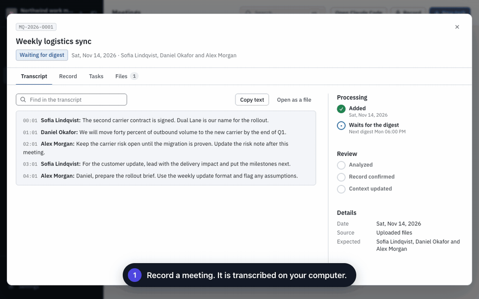
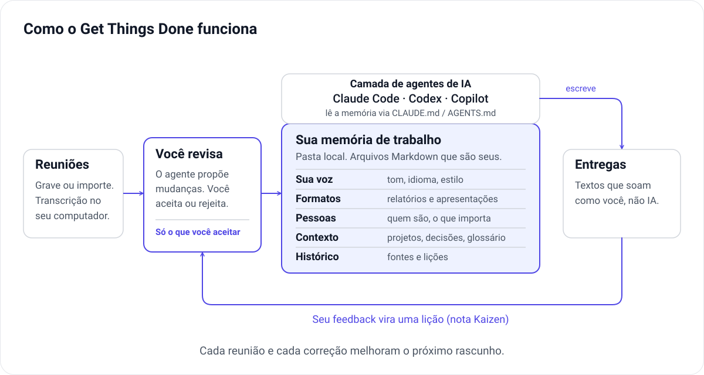

[English](README.md) · [日本語](README.ja.md) · [Português (Brasil)](README.pt-BR.md) · [Español](README.es.md)

<div align="center">

# Get Things Done

**Uma memória para a IA que cresce com o seu trabalho.**

Registre reuniões, revise o que mudou e dê à sua IA o contexto necessário para entregar resultados.



<sub>Telas reais do painel com dados fictícios de demonstração. As legendas foram adicionadas para esta animação.</sub>

</div>

Get Things Done é uma **memória de trabalho** de código aberto, local, para **Claude Code, Codex e GitHub Copilot**. Ela guarda em arquivos Markdown simples o seu jeito de escrever, os formatos que você entrega, as pessoas com quem você trabalha e o que foi decidido nos seus projetos. O agente de IA lê esses arquivos antes de escrever qualquer coisa.

**A memória se retroalimenta.** Cada reunião gravada traz o que mudou. Cada correção que você faz em um rascunho vira uma lição. Você aprova cada mudança, então a memória melhora sem virar bagunça, e o próximo rascunho pede menos explicação e menos ajuste.

## Como funciona, em resumo



1. **As reuniões trazem conhecimento novo.** Grave ou importe uma reunião. A transcrição acontece no seu computador.
2. **Você decide o que a memória aprende.** Um agente compara a reunião com o que o espaço de trabalho já sabe e propõe poucas mudanças: uma decisão nova, um prazo que mudou, um termo novo para o glossário, o que um colega espera. Nada entra sem a sua aprovação.
3. **A memória é o cérebro sobre o qual o agente roda.** Sua voz e preferências, modelos de saída, pessoas, notas de contexto e tarefas anteriores ficam em uma única pasta. Claude Code, Codex ou Copilot lê tudo pelo próprio arquivo de instruções (`CLAUDE.md`, `AGENTS.md` ou `.github/copilot-instructions.md`).
4. **Os rascunhos parecem seus, não de uma IA.** O agente escreve no seu tom e nos seus formatos, pensando no que importa para cada leitor. Você revisa e decide quando está pronto.
5. **As correções fecham o ciclo.** Quando você devolve um rascunho, o agente registra por que a primeira versão errou (uma nota Kaizen). Ela vira uma proposta de ajuste nas instruções ou na memória, que você revisa como qualquer outra mudança.

## Comece aqui

### Aplicativo desktop

[Baixe para macOS ou Windows](https://github.com/geovanneb/get-things-done/releases/latest). Escolha o instalador da sua plataforma e leia as notas da versão. As versões para macOS são assinadas e notarizadas; a de Windows ainda é uma prévia sem assinatura.

### CLI e navegador

Requer **Node.js 20.19 ou superior**; recomendamos 22 ou 24.

```bash
npm install -g @bertonha/getthingsdone
mkdir work-memory && cd work-memory
gtd init
gtd start
```

Escolha sua ferramenta de IA durante a configuração. O painel local abre no navegador.

## Experimente o ciclo

1. Cadastre uma pessoa com quem você trabalha e escreva algumas linhas sobre o seu projeto.
2. Grave uma reunião ou importe gravações e transcrições. Avise os participantes e obtenha consentimento antes de gravar.
3. Antes de transcrever áudio, baixe um modelo em **Configurações → Transcrição**.
4. Revise e aprove as mudanças propostas pela IA. Crie uma tarefa que use esse contexto.
5. Se o rascunho não ficar bom, use **Pedir mudanças**. A lição volta para a memória depois da sua revisão.

O espaço de trabalho e a transcrição offline não exigem uma conta do Get Things Done. A análise e a execução de tarefas usam a ferramenta de IA que você escolher, que pode exigir conta ou assinatura própria. Você aprova as mudanças e revisa as entregas.

## Idioma

O painel está em inglês, japonês, português do Brasil e espanhol. Ele segue o idioma do sistema ou do navegador, e você pode trocar em **Configurações → Aparência → Idioma**. Os menus nativos do aplicativo desktop, a CLI e alguns erros do servidor ainda estão em inglês.

O idioma da interface é independente do idioma falado nas gravações e do idioma em que a IA escreve as entregas, que você define no seu perfil.

## Documentação e participação

- [Apresentação completa (inglês)](README.md)
- [Guia do usuário (inglês)](docs/user-guide.md)
- [Histórico de mudanças](CHANGELOG.md) e [como contribuir](CONTRIBUTING.md)
- [Bugs e sugestões](https://github.com/geovanneb/get-things-done/issues) e [relatos de segurança](SECURITY.md)

Contribuições para as traduções são bem-vindas. Use dados fictícios em issues e capturas de tela, nunca informações reais do trabalho.

[Licença MIT](LICENSE). Esta página é um resumo do README em inglês; consulte a versão completa para os detalhes.

<!-- English source: README.md as revised for 0.13.1 (memory loop and diagram); concise introduction, not a full translation. -->
